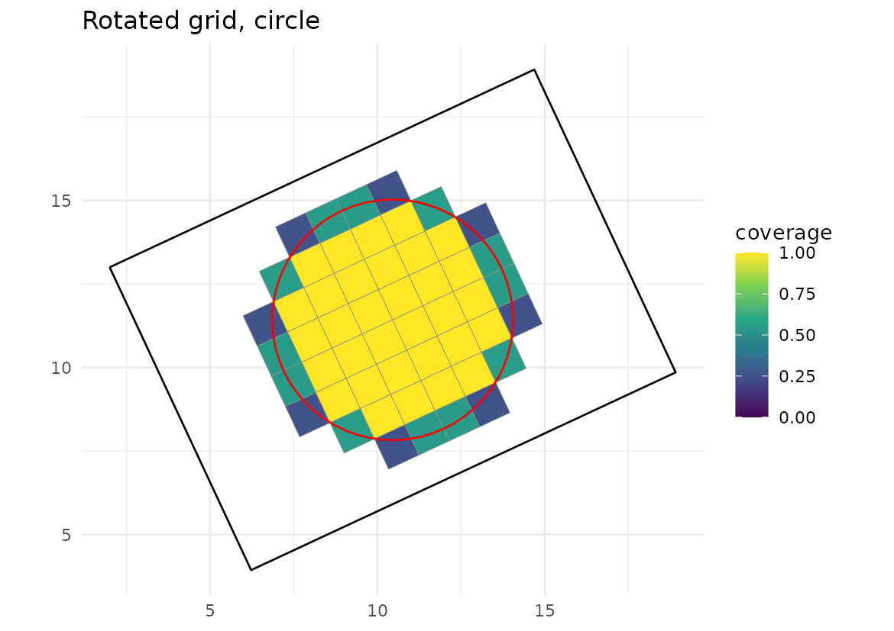
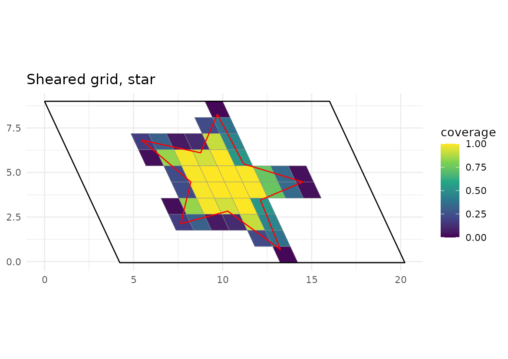
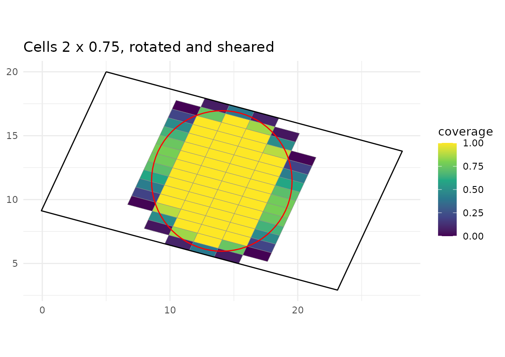
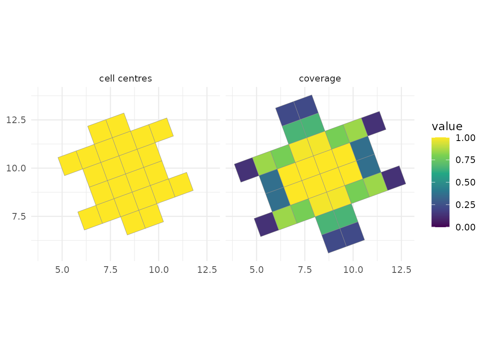
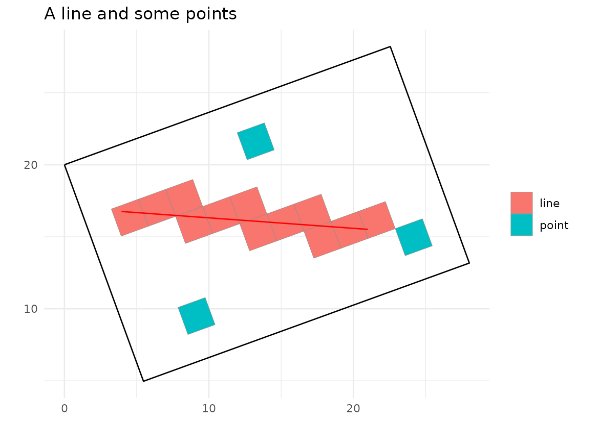

# Rotated and sheared grids

[`cb_burn()`](https://mdsumner.github.io/cbr/reference/cb_burn.md) takes
an axis-aligned extent. Many grids are not that: a raster with a rotated
or sheared geotransform, a swath, a satellite scene on a slanted pixel
lattice.
[`cb_burn_index()`](https://mdsumner.github.io/cbr/reference/cb_burn_index.md)
takes a GDAL-style geotransform instead.

The idea is small. Move the geometry into the grid’s *index space*
(fractional column and row) with the inverse of the geotransform, and
burn it on a lattice of unit cells. The records that come back are
already in the grid’s own `(row, col)`. Because the map from world to
index space is affine, straight edges stay straight, and the coverage
fraction of a boundary cell is exactly the fraction of that cell’s area
(in world units) that the geometry covers. Nothing is resampled and
nothing is approximated, whatever the rotation, shear or aspect of the
cells.

This page is a gallery of cases, each checked against something
independent.

``` r

library(cbr)
library(ggplot2)

## pixel position (col, row; 0-based, from the top-left corner) -> world
world <- function(gt, col, row) {
  cbind(gt[1] + col * gt[2] + row * gt[3], gt[4] + col * gt[5] + row * gt[6])
}
poly_wkt <- function(...) {
  rings <- list(...)
  txt <- vapply(rings, function(m) {
    m[nrow(m), ] <- m[1, ]
    paste0("(", paste(sprintf("%.15g %.15g", m[, 1], m[, 2]), collapse = ", "), ")")
  }, "")
  wk::wkt(sprintf("POLYGON (%s)", paste(txt, collapse = ", ")))
}
shoelace <- function(m) {
  n <- nrow(m)
  abs(sum(m[-n, 1] * m[-1, 2] - m[-1, 1] * m[-n, 2])) / 2
}
cell_area <- function(gt) abs(gt[2] * gt[6] - gt[3] * gt[5])
## covered area in world units, from the burn alone
burn_area <- function(b) {
  n <- sum(b$runs$col_end - b$runs$col_start + 1L) + sum(b$edges$fraction)
  n * cell_area(attr(b, "geotransform"))
}
## the grid and the burn, in world coordinates
show_burn <- function(b, geom, fill = c("coverage", "kind"), title = NULL) {
  fill <- match.arg(fill)
  gt <- attr(b, "geotransform")
  dm <- attr(b, "dimension")
  cells <- cb_cells(b)
  frame <- as.data.frame(world(gt, c(0, dm[1], dm[1], 0, 0), c(0, 0, dm[2], dm[2], 0)))
  names(frame) <- c("x", "y")
  co <- wk::wk_coords(wk::as_wkb(geom))
  co$g <- interaction(co$feature_id, co$part_id, co$ring_id)
  p <- ggplot() +
    geom_polygon(data = cells,
                 aes(x, y, group = cell, fill = if (fill == "kind") kind else value),
                 colour = "grey55", linewidth = 0.15) +
    geom_path(data = frame, aes(x, y), colour = "black") +
    geom_path(data = co, aes(x, y, group = g), colour = "red", linewidth = 0.5) +
    coord_equal() + labs(title = title, x = NULL, y = NULL) + theme_minimal()
  if (fill == "coverage") {
    p + scale_fill_viridis_c(limits = c(0, 1), name = "coverage")
  } else {
    p + scale_fill_discrete(name = NULL)
  }
}
```

## A rotated grid

A 14 by 10 grid with unit cells, turned 25 degrees counter-clockwise,
and a circle of radius 3.6 near its middle.
[`cb_geotransform()`](https://mdsumner.github.io/cbr/reference/cb_geotransform.md)
writes the six GDAL numbers from an origin (the grid’s top-left corner),
a cell size, a rotation and a shear.

``` r

gt <- cb_geotransform(origin = c(2, 13), res = 1, rotation = 25)
gt
#> [1]  2.0000000  0.9063078  0.4226183 13.0000000  0.4226183 -0.9063078

ang <- seq(0, 2 * pi, length.out = 61)
ring <- world(gt, 7 + 3.6 * cos(ang), 5 + 3.6 * sin(ang))
circle <- poly_wkt(ring)

b <- cb_burn_index(circle, gt, dimension = c(14, 10))
b
#> <cb_burn>
#>   grid:   14 col x 10 row
#>   extent: x[0, 14] y[0, 10]
#>   affine: geotransform c( 2.000000,  0.906308,  0.422618, 13.000000,  0.422618, -0.906308)
#>   world:  x[2, 18.9145] y[3.93692, 18.9167] (extent above is index space)
#>   mode:   coverage
#>   tables: runs=6, edges=28, lines=0, points=0, notes=0
show_burn(b, circle, title = "Rotated grid, circle")
```



Full cells come back as runs along the grid’s own rows; only the
boundary cells carry a fraction. The covered area, summed from the burn,
equals the area of the polygon:

``` r

c(burn = burn_area(b), polygon = shoelace(ring))
#>     burn  polygon 
#> 40.64067 40.64067
```

The same fractions can be had the slow way, by clipping each cell’s
quadrilateral with the polygon, using a general geometry library. They
agree to the single precision of the `edges` table.

``` r

cell_poly <- function(gt, col, row) {
  sf::st_polygon(list(rbind(world(gt, col, row), world(gt, col + 1, row),
                            world(gt, col + 1, row + 1), world(gt, col, row + 1),
                            world(gt, col, row))))
}
target <- sf::st_polygon(list({ r <- ring; r[nrow(r), ] <- r[1, ]; r }))
ref <- vapply(seq_len(14 * 10) - 1L, function(i) {
  cell <- cell_poly(gt, i %% 14, i %/% 14)
  hit <- sf::st_intersection(cell, target)
  if (length(hit)) as.numeric(sf::st_area(hit) / sf::st_area(cell)) else 0
}, numeric(1))
got <- as.vector(cb_materialize(b, background = 0))
max(abs(got - ref))
#> [1] 2.887116e-08
```

## A sheared grid

Shear turns the direction in which rows increase away from
perpendicular, so the cells are parallelograms. Nothing else changes.

``` r

gt <- cb_geotransform(origin = c(0, 9), res = 1, shear = 25)
a <- seq(0, 2 * pi, length.out = 11)
r <- rep(c(4.4, 1.9), length.out = 11)
ring <- world(gt, 8 + r * cos(a), 5 + r * sin(a))
star <- poly_wkt(ring)

b <- cb_burn_index(star, gt, dimension = c(16, 10))
show_burn(b, star, title = "Sheared grid, star")
```



``` r

c(burn = burn_area(b), polygon = shoelace(ring))
#>     burn  polygon 
#> 22.26746 22.26746
```

## Cells that are not square

Cell sizes can differ in the two directions, and combine with rotation
and shear. Fractions are fractions of the cell’s *own* area, so they are
still exact.

``` r

gt <- cb_geotransform(origin = c(5, 20), res = c(2, 0.75), rotation = -15, shear = -10)
centre <- world(gt, 6, 8)
ang <- seq(0, 2 * pi, length.out = 73)
ring <- cbind(centre[1] + 5.5 * cos(ang), centre[2] + 5.5 * sin(ang))
disc <- poly_wkt(ring)

b <- cb_burn_index(disc, gt, dimension = c(12, 16))
show_burn(b, disc, title = "Cells 2 x 0.75, rotated and sheared")
```



``` r

c(burn = burn_area(b), polygon = shoelace(ring))
#>    burn polygon 
#> 94.9126 94.9126
```

## Coverage or cell centres

By default the burn gives exact coverage. `coverage = FALSE` uses the
cell-centre rule (the usual “fasterize” meaning of rasterizing a
polygon) and returns whole cells only, much faster on big inputs. On a
rotated grid the difference is easy to see:

``` r

gt <- cb_geotransform(origin = c(0, 12), res = 1, rotation = 20)
a <- seq(0, 2 * pi, length.out = 13)
ring <- world(gt, 7 + c(4, 2)[(seq_along(a) %% 2) + 1] * cos(a),
              5 + c(4, 2)[(seq_along(a) %% 2) + 1] * sin(a))
shape <- poly_wkt(ring)

exact <- cb_burn_index(shape, gt, c(14, 10))
centre <- cb_burn_index(shape, gt, c(14, 10), coverage = FALSE)
both <- rbind(cbind(cb_cells(exact), mode = "coverage"),
              cbind(cb_cells(centre), mode = "cell centres"))
ggplot(both, aes(x, y, group = cell, fill = value)) +
  geom_polygon(colour = "grey55", linewidth = 0.15) +
  coord_equal() + facet_wrap(~mode) + theme_minimal() +
  scale_fill_viridis_c(limits = c(0, 1), name = "value") +
  labs(x = NULL, y = NULL)
```



``` r

c(coverage = burn_area(exact), cell_centres = burn_area(centre), polygon = shoelace(ring))
#>     coverage cell_centres      polygon 
#>           24           24           24
```

The two answers are different questions: the cell-centre rule says which
cells have their centre inside the polygon, not how much of each cell is
covered, so its cells need not add up to the polygon’s area. For this
shape the totals happen to coincide, with cells gained and lost along
the boundary balancing out; the cells themselves clearly differ.

## Real coordinates

Nothing about the method cares how big the world coordinates are. Here
is a UTM-sized north-up grid, where the geotransform is the usual one
for a raster file. Going through index space gives the same records as
burning on the regular extent directly:

``` r

gt <- c(432100, 30, 0, 5810900, 0, -30)
wedge <- wk::wkt("POLYGON ((432250.5 5810410.2, 432840.9 5810530.7,
                            432700.3 5810150.8, 432250.5 5810410.2))")
viaindex <- cb_burn_index(wedge, gt, c(40, 30), crs = "EPSG:32755")
regular <- cb_burn(wedge, extent = c(432100, 432100 + 40 * 30, 5810900 - 30 * 30, 5810900),
                   dimension = c(40, 30))
all.equal(viaindex$edges, regular$edges, tolerance = 1e-5)
#> [1] TRUE
all.equal(viaindex$runs, regular$runs)
#> [1] TRUE
attr(viaindex, "world_extent")
#> [1]  432100  433300 5810000 5810900
attr(viaindex, "crs")
#> [1] "EPSG:32755"
```

## Lines and points

Lines report the length inside each cell and points report the cell they
fall in. When the cells are similar to squares (equal sides at right
angles, at any rotation) the lengths come back in world units.

``` r

gt <- cb_geotransform(origin = c(0, 20), res = 2, rotation = 20)
p <- world(gt, 1.3, 2.2)
q <- world(gt, 9.1, 5.7)
pts <- world(gt, c(2.5, 6.5, 10.5), c(6.5, 1.5, 6.5))
geoms <- wk::wkt(c(
  sprintf("LINESTRING (%.15g %.15g, %.15g %.15g)", p[1], p[2], q[1], q[2]),
  sprintf("MULTIPOINT ((%.15g %.15g), (%.15g %.15g), (%.15g %.15g))",
          pts[1, 1], pts[1, 2], pts[2, 1], pts[2, 2], pts[3, 1], pts[3, 2])
))
b <- cb_burn_index(geoms, gt, c(12, 8))
show_burn(b, geoms, fill = "kind", title = "A line and some points")
```



``` r

c(burned = sum(b$lines$length), exact = sqrt(sum((p - q)^2)))
#>   burned    exact 
#> 17.09854 17.09854
```

## Several geometries

Each input geometry gets an `id`, so overlaps are kept apart.
[`summary()`](https://rdrr.io/r/base/summary.html) is in index space and
works as it does for any burn:

``` r

gt <- cb_geotransform(origin = c(0, 12), res = 1, rotation = 15, shear = 10)
discs <- poly_wkt(world(gt, 4 + 3 * cos(ang), 5 + 3 * sin(ang)))
for (centre in list(c(8, 4), c(7, 7))) {
  discs <- c(discs, poly_wkt(world(gt, centre[1] + 3 * cos(ang), centre[2] + 3 * sin(ang))))
}
b <- cb_burn_index(discs, gt, c(14, 10))
summary(b)$area
#>   id interior boundary lines points
#> 1  1       16 12.23846     0      0
#> 2  2       16 12.23846     0      0
#> 3  3       16 12.23846     0      0
table(cells_touched = cb_materialize(b, "count"), useNA = "ifany")
#> cells_touched
#>    1    2    3 <NA> 
#>   52   19    6   63
```

## Cropping

A burn is sparse, so a small shape on a big grid costs almost nothing.
Before making a dense array,
[`cb_crop()`](https://mdsumner.github.io/cbr/reference/cb_crop.md) snaps
the burn to the cells it touches. On an affine grid that moves the
origin of the geotransform to the window’s top-left cell and leaves the
cells where they were.
[`cb_materialize()`](https://mdsumner.github.io/cbr/reference/cb_materialize.md)
then describes the cropped grid, including its geotransform:

``` r

gt <- cb_geotransform(origin = c(100, 400), res = 5, rotation = 35, shear = 5)
small <- poly_wkt(world(gt, 40 + 6 * cos(ang), 22 + 4 * sin(ang)))
big <- cb_burn_index(small, gt, c(300, 200), crs = "EPSG:32755")
tight <- cb_crop(big)
c(full = prod(attr(big, "dimension")), cropped = prod(attr(tight, "dimension")))
#>    full cropped 
#>   60000      96
str(attr(cb_materialize(tight), "gis"))
#> List of 6
#>  $ type        : chr "raster"
#>  $ bbox        : num [1:4] 297 398 372 463
#>  $ dim         : num [1:3] 12 8 1
#>  $ srs         : chr "EPSG:32755"
#>  $ datatype    : chr "Float32"
#>  $ geotransform: num [1:6] 297.11 4.1 3.21 428.56 2.87 ...
```

The `bbox` there is the bounding box of the cropped grid’s outline in
world coordinates; the `geotransform` is what says where each cell is.
