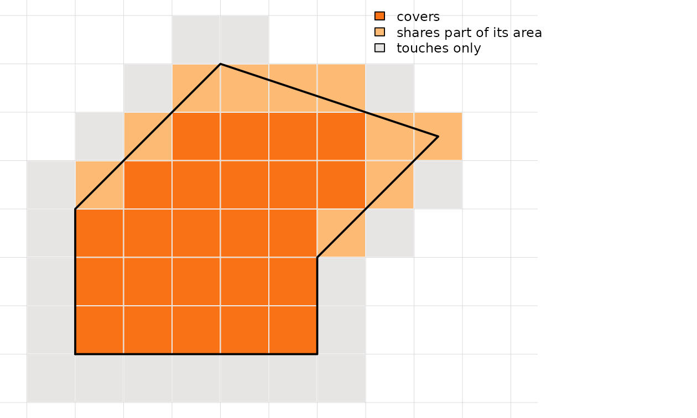
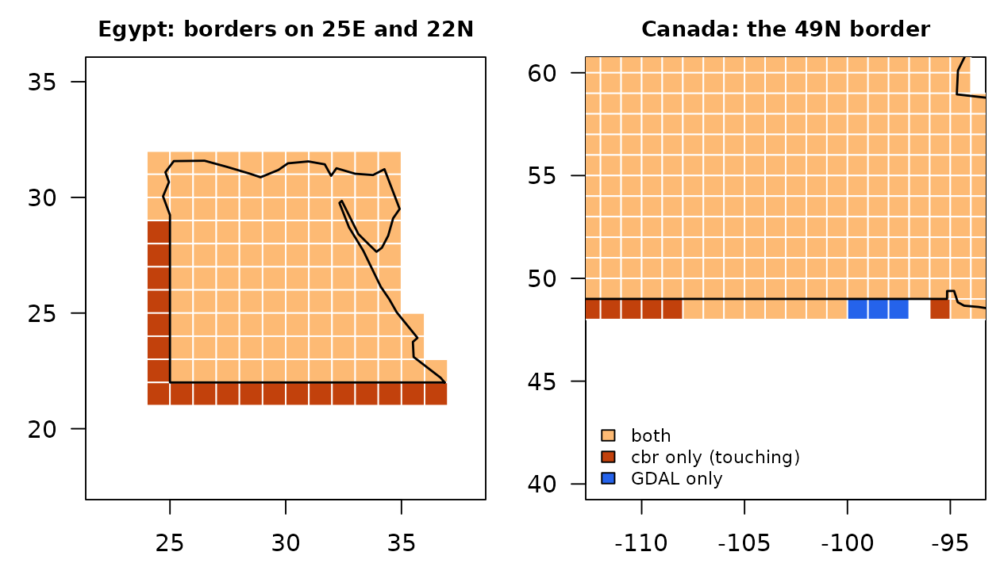

# Cell predicates: exact all-touched and slivers

A burn is a lookup table. To ask whether a point is inside a polygon,
find the point’s cell: if the cell is in a run the answer is yes, if it
has no record the answer is no, and only an edge cell needs the polygon
itself.

`relate = TRUE` takes that idea from points to cells, and from “inside”
to every spatial predicate. For each polygon and each grid cell it gives
the **DE-9IM matrix**: nine entries saying how the polygon’s interior,
boundary and exterior meet the cell’s interior, boundary and exterior,
each `F` (empty) or the dimension `0`, `1` or `2` of the intersection.
The crate computes it after the burn, from the geometry, and only for
the cells the polygon’s boundary touches. Every other cell is already
answered by the burn.

## One polygon

The polygon from the crate’s book has edges along cell walls and
diagonals through cell corners.

``` r

library(cbr)
ring <- rbind(c(1, 1), c(6, 1), c(6, 3), c(8.5, 5.5), c(4, 7), c(1, 4), c(1, 1))
g <- wk::wkt(sprintf("POLYGON ((%s))", paste(ring[, 1], ring[, 2], collapse = ", ")))
b <- cb_burn(g, extent = c(0, 10, 0, 8), dimension = c(10, 8), relate = TRUE)
b
#> <cb_burn>
#>   grid:   10 col x 8 row
#>   extent: x[0, 10] y[0, 8]
#>   mode:   coverage
#>   tables: runs=5, edges=10, lines=0, points=0, notes=0, relations=43
head(b$relations)
#>   row col id    matrix
#> 1   1   4  1 FF2F01212
#> 2   1   5  1 FF2F01212
#> 3   2   3  1 FF2F01212
#> 4   2   4  1 212101212
#> 5   2   5  1 212101212
#> 6   2   6  1 212101212
```

The relations hold the cells the boundary touches: 43 here. Any cell’s
matrix comes from
[`cb_matrix()`](https://mdsumner.github.io/cbr/reference/cb_matrix.md),
which falls back on the burn for the rest: a cell in a run is covered
(`212FF1FF2`), any other is disjoint (`FF2FF1212`).

``` r

cells <- data.frame(row = c(5, 7, 8, 1, 1), col = c(4, 3, 3, 4, 10),
                    what = c("deep inside", "above the bottom edge", "below the bottom edge",
                             "at the top vertex", "far away"))
cells$matrix <- cb_matrix(b, cells$row, cells$col)
cells
#>   row col                  what    matrix
#> 1   5   4           deep inside 212FF1FF2
#> 2   7   3 above the bottom edge 212F11FF2
#> 3   8   3 below the bottom edge FF2F11212
#> 4   1   4     at the top vertex FF2F01212
#> 5   1  10              far away FF2FF1212
```

The cell below the bottom edge shares a line with the polygon (boundary
against boundary is `1`) and no area. The one at the top vertex shares a
single point (`0`). Neither has a record in the burn: no part of them is
covered. They are exactly the cells an *all-touched* rasterization
should add, and the ones a burn’s records cannot find.

[`cb_cells_where()`](https://mdsumner.github.io/cbr/reference/cb_cells_where.md)
selects cells by predicate:

``` r

sapply(c("intersects", "interiors_meet", "covers", "touches"),
       function(p) nrow(cb_cells_where(b, p)))
#>     intersects interiors_meet         covers        touches 
#>             54             34             24             20
c(cells_with_a_record = sum(!is.na(cb_materialize(b, "count"))),
  cells_touched = sum(!is.na(cb_materialize(b, "intersects"))))
#> cells_with_a_record       cells_touched 
#>                  34                  54
```

``` r

draw_cells <- function(b, ring) {
  dm <- attr(b, "dimension")
  plot(NA, xlim = c(0, dm[1]), ylim = c(0, dm[2]), asp = 1, axes = FALSE, xlab = "", ylab = "")
  cell <- function(t, ...) rect(t$col - 1, dm[2] - t$row, t$col, dm[2] - t$row + 1, ...)
  covers <- cb_cells_where(b, "covers")
  part <- cb_cells_where(b, "interiors_meet")
  part <- part[!paste(part$row, part$col) %in% paste(covers$row, covers$col), ]
  cell(covers, col = "#f97316", border = "white")
  cell(part, col = "#fdba74", border = "white")
  cell(cb_cells_where(b, "touches"), col = "#e7e5e4", border = "white")
  abline(v = 0:dm[1], h = 0:dm[2], col = "grey85", lwd = 0.5)
  lines(ring, lwd = 2)
  legend("topright", inset = c(-0.02, 0), bty = "n", cex = 0.8, xpd = NA,
         fill = c("#f97316", "#fdba74", "#e7e5e4"),
         legend = c("covers", "shares part of its area", "touches only"))
}
par(mar = c(0, 0, 0, 8))
draw_cells(b, ring)
```



## Exact all-touched, against GDAL

GDAL’s rasterizer has an *all-touched* mode, which
`terra::rasterize(touches = TRUE)` uses: a cell is burned if the
polygon’s boundary passes through it. It is a fast, widely used
approximation. With the relations, cbr’s
`cb_materialize(value = "intersects")` is the exact version: every cell
whose closed box shares at least a point with the polygon.

The difference shows where boundaries run along cell walls. Natural
Earth draws several borders on meridians and parallels: Egypt’s with
Libya on 25°E and with Sudan on 22°N, and the United States’ with Canada
on 49°N. On a 1° grid those borders lie exactly on cell walls.

``` r

ne <- readRDS(system.file("extdata", "ne_110m_countries.rds", package = "cbr"))
countries <- ne$geometry
world <- cb_burn(countries, extent = c(-180, 180, -90, 90), dimension = c(360, 180), relate = TRUE)
world
#> <cb_burn>
#>   grid:   360 col x 180 row
#>   extent: x[-180, 180] y[-90, 90]
#>   mode:   coverage
#>   tables: runs=1266, edges=9557, lines=0, points=0, notes=0, relations=10092
touched <- cb_cells_where(world, "intersects")
touched$cell <- (touched$row - 1L) * 360L + touched$col
```

``` r

r <- terra::rast(nrows = 180, ncols = 360, xmin = -180, xmax = 180, ymin = -90, ymax = 90,
                 crs = "OGC:CRS84")
v <- terra::vect(as.character(wk::as_wkt(countries)), crs = "OGC:CRS84")
gdal <- lapply(seq_along(v), function(k) {
  which(!is.na(terra::values(terra::rasterize(v[k], r, touches = TRUE), mat = FALSE)))
})
exact <- split(touched$cell, factor(touched$id, levels = seq_along(v)))
cmp <- data.frame(country = ne$name, cbr = lengths(exact), gdal = lengths(gdal),
                  only_cbr = mapply(function(a, b) length(setdiff(a, b)), exact, gdal),
                  only_gdal = mapply(function(a, b) length(setdiff(b, a)), exact, gdal))
colSums(cmp[-1])
#>       cbr      gdal  only_cbr only_gdal 
#>     26749     26670        83         4
cmp[cmp$only_cbr + cmp$only_gdal > 0, ]
#>                      country  cbr gdal only_cbr only_gdal
#> 4                     Canada 2177 2164       16         3
#> 5   United States of America 1343 1324       19         0
#> 15                     Sudan  204  188       16         0
#> 20                   Bahamas    9    8        1         0
#> 89                      Oman   45   44        1         0
#> 164                    Egypt  127  107       20         0
#> 165                    Libya  191  182       10         1
```

The two agree on all but six countries, those with borders on cell
walls. cbr finds 82 cells GDAL misses, and GDAL has 4 cells cbr does
not. Which is right can be settled cell by cell with GEOS, relating each
country to each disputed cell’s box:

``` r

old <- suppressMessages(sf::sf_use_s2(FALSE))
box <- function(cell) {
  row <- (cell - 1) %/% 360 + 1; col <- (cell - 1) %% 360 + 1
  x0 <- -180 + col - 1; y1 <- 90 - (row - 1)
  sf::st_sfc(sf::st_polygon(list(rbind(c(x0, y1 - 1), c(x0 + 1, y1 - 1), c(x0 + 1, y1),
                                       c(x0, y1), c(x0, y1 - 1)))))
}
geos <- function(id, cells) {
  p <- sf::st_as_sfc(wk::as_wkt(countries[id]))
  vapply(cells, function(cl) sf::st_relate(p, box(cl))[1, 1], "")
}
disputed <- do.call(rbind, lapply(which(cmp$only_cbr + cmp$only_gdal > 0), function(k) {
  only_cbr <- setdiff(exact[[k]], gdal[[k]])
  only_gdal <- setdiff(gdal[[k]], exact[[k]])
  data.frame(id = k, cell = c(only_cbr, only_gdal),
             found_by = rep(c("cbr only", "GDAL only"), c(length(only_cbr), length(only_gdal))))
}))
disputed$geos <- mapply(function(id, cl) geos(id, cl), disputed$id, disputed$cell)
disputed$cbr <- cb_matrix(world, (disputed$cell - 1) %/% 360 + 1, (disputed$cell - 1) %% 360 + 1, disputed$id)
with(disputed, table(found_by, geos_intersects = geos != "FF2FF1212"))
#>            geos_intersects
#> found_by    FALSE TRUE
#>   cbr only      0   83
#>   GDAL only     4    0
with(disputed, table(found_by, same_matrix_as_cbr = geos == cbr))
#>            same_matrix_as_cbr
#> found_by    TRUE
#>   cbr only    83
#>   GDAL only    4
invisible(suppressMessages(sf::sf_use_s2(old)))
```

Every cell cbr adds does meet its country, nearly all along a wall or at
a corner, with exactly the matrix GEOS computes; the cells GDAL adds are
a fraction of a thousandth of a degree away from the country, burned by
rounding.

``` r

outline <- function(id) {
  xy <- wk::wk_coords(countries[id])
  for (k in unique(paste(xy$part_id, xy$ring_id))) {
    s <- xy[paste(xy$part_id, xy$ring_id) == k, ]
    lines(s$x, s$y, lwd = 1.5)
  }
}
show <- function(id, xlim, ylim, title) {
  plot(NA, xlim = xlim, ylim = ylim, asp = 1, xlab = "", ylab = "", las = 1)
  draw <- function(cells, col) {
    row <- (cells - 1) %/% 360 + 1; col_ <- (cells - 1) %% 360 + 1
    rect(-180 + col_ - 1, 90 - row, -180 + col_, 90 - row + 1, col = col, border = "white")
  }
  draw(intersect(exact[[id]], gdal[[id]]), "#fdba74")
  draw(setdiff(exact[[id]], gdal[[id]]), "#c2410c")
  draw(setdiff(gdal[[id]], exact[[id]]), "#2563eb")
  outline(id)
  title(title, cex.main = 0.9)
}
egypt <- match("Egypt", ne$name); canada <- match("Canada", ne$name)
par(mfrow = c(1, 2), mar = c(2.5, 3, 2, 0.5))
show(egypt, c(22, 38), c(20, 33), "Egypt: borders on 25E and 22N")
show(canada, c(-112, -94), c(44, 56), "Canada: the 49N border")
legend("bottomleft", bty = "n", cex = 0.75, fill = c("#fdba74", "#c2410c", "#2563eb"),
       legend = c("both", "cbr only (touching)", "GDAL only"))
```



## Slivers the burn rounds away

The burn treats a coverage within 1e-6 of 0 or 1 as exactly 0 or 1, as
the crate’s C++ ancestor and exactextract do. That is right for area:
the error is at most a millionth of a cell. But it means a cell holding
a sliver of a country can have no record, and a cell holding a sliver of
a country’s exterior can be in a run. The relations come from the
geometry, not the records, so
[`cb_slivers()`](https://mdsumner.github.io/cbr/reference/cb_slivers.md)
can list those cells:

``` r

s <- cb_slivers(world)
s$country <- ne$name[s$id]
s$lon <- -180 + s$col - 0.5
s$lat <- 90 - s$row + 0.5
table(s$kind)
#> 
#> exterior interior 
#>        6       12
s[, c("country", "lon", "lat", "kind", "matrix")]
#>                     country    lon   lat     kind    matrix
#> 1                 W. Sahara  -17.5  20.5 interior 212101212
#> 2                    Canada  -66.5  59.5 interior 212101212
#> 3                    Canada  -60.5  56.5 interior 212101212
#> 4                    Canada -107.5  48.5 interior 212111212
#> 5  United States of America -167.5  66.5 interior 212101212
#> 6  United States of America -107.5  48.5 exterior 212111212
#> 7  United States of America  -69.5  44.5 exterior 212101212
#> 8                     Sudan   33.5   8.5 exterior 212101212
#> 9              South Africa   26.5 -29.5 exterior 212101212
#> 10                  Lesotho   26.5 -29.5 interior 212101212
#> 11                     Cuba  -83.5  21.5 interior 212101212
#> 12               Madagascar   50.5 -16.5 interior 212101212
#> 13                     Oman   54.5  20.5 interior 212101212
#> 14                    Yemen   51.5  19.5 interior 212101212
#> 15                    Yemen   52.5  19.5 interior 212101212
#> 16             Saudi Arabia   54.5  20.5 exterior 212101212
#> 17             Saudi Arabia   51.5  19.5 exterior 212101212
#> 18               Antarctica  -60.5 -81.5 interior 212101212
```

An `interior` sliver is a cell that shares area with the country
although the burn has no record there; an `exterior` sliver is a run
cell that the country does not in fact cover.

The relation of a polygon to a cell is only defined for valid polygons,
and the crate assumes them. Two countries in this dataset are not valid,
so it is worth checking before reading the table:

``` r

old <- suppressMessages(sf::sf_use_s2(FALSE))
polys <- sf::st_as_sfc(wk::as_wkt(countries))
valid <- sf::st_is_valid(polys)
data.frame(country = ne$name[!valid], problem = sf::st_is_valid(polys[!valid], reason = TRUE))
#>                    country
#> 1 United States of America
#> 2                    Sudan
#>                                                 problem
#> 1 Self-intersection[-140.986000000796 69.7119995456579]
#> 2  Self-intersection[33.9633927979515 9.46428502886449]
```

How far off the burn’s record is in each cell, from sf’s area of the
country inside the cell:

``` r

s$valid <- valid[s$id]
s$area_share <- mapply(function(id, row, col) {
  cell <- sf::st_sfc(sf::st_polygon(list(rbind(c(-180 + col - 1, 90 - row), c(-180 + col, 90 - row),
                                                c(-180 + col, 91 - row), c(-180 + col - 1, 91 - row),
                                                c(-180 + col - 1, 90 - row)))))
  hit <- sf::st_intersection(polys[id], cell)
  if (length(hit)) sum(as.numeric(sf::st_area(hit))) / as.numeric(sf::st_area(cell)) else 0
}, s$id, s$row, s$col)
s$off_by <- ifelse(s$kind == "interior", s$area_share, 1 - s$area_share)
s[, c("country", "lon", "lat", "kind", "valid", "off_by")]
#>                     country    lon   lat     kind valid       off_by
#> 1                 W. Sahara  -17.5  20.5 interior  TRUE 1.698959e-08
#> 2                    Canada  -66.5  59.5 interior  TRUE 1.206668e-09
#> 3                    Canada  -60.5  56.5 interior  TRUE 7.953205e-07
#> 4                    Canada -107.5  48.5 interior  TRUE 5.829952e-08
#> 5  United States of America -167.5  66.5 interior FALSE 5.732763e-07
#> 6  United States of America -107.5  48.5 exterior FALSE 5.829952e-08
#> 7  United States of America  -69.5  44.5 exterior FALSE 3.717902e-08
#> 8                     Sudan   33.5   8.5 exterior FALSE 1.000000e+00
#> 9              South Africa   26.5 -29.5 exterior  TRUE 6.026131e-07
#> 10                  Lesotho   26.5 -29.5 interior  TRUE 6.026131e-07
#> 11                     Cuba  -83.5  21.5 interior  TRUE 1.285839e-07
#> 12               Madagascar   50.5 -16.5 interior  TRUE 4.083449e-08
#> 13                     Oman   54.5  20.5 interior  TRUE 3.839942e-10
#> 14                    Yemen   51.5  19.5 interior  TRUE 1.049515e-11
#> 15                    Yemen   52.5  19.5 interior  TRUE 2.548545e-11
#> 16             Saudi Arabia   54.5  20.5 exterior  TRUE 3.839925e-10
#> 17             Saudi Arabia   51.5  19.5 exterior  TRUE 1.049516e-11
#> 18               Antarctica  -60.5 -81.5 interior  TRUE 8.518320e-07
invisible(suppressMessages(sf::sf_use_s2(old)))
```

Seventeen of the eighteen are genuine: the burn’s record is off by less
than a millionth of a cell, within its tolerance, and the relation sees
the sliver. The exception is Sudan’s cell at 33.5°E, 8.5°N. Sudan’s ring
crosses itself just north of it, at 33.96°E, 9.46°N, and for a
self-crossing ring “inside” has no single meaning: the burn fills by
winding and counts the cell as covered, while GEOS’s repaired polygon
covers only a hundred-millionth of it. That row is not a sliver but
invalid input, which
[`sf::st_make_valid()`](https://r-spatial.github.io/sf/reference/valid.html)
(or a cleaner source) should fix before burning. (The United States is
also invalid, but where Alaska meets the Yukon, away from its sliver
cells.)

None of this changes an area: the coverage fractions are what they
should be to a millionth of a cell. It changes topology, and for a
question like “which countries touch this cell”, topology is the answer.
